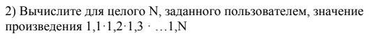
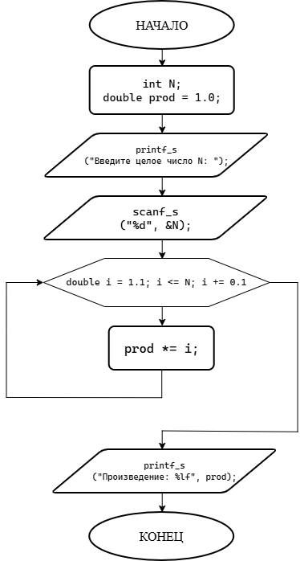
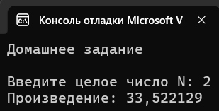

# Домашние задания к работе 8 (Вариант 2) #
## Условие задачи ##



Создать программу вычисляющее значение произведения с последовательным шагом 0,1 для целого числа, заданного пользователем

## 1. Алгоритм и блок-схема ##

### Алгоритм ###
Алгоритм программы заключается в вводе числа и выводом значения посредством создания счётчика
1. **Начало**
2. Объявляем переменную для целого числа которое будет вводить пользователь:

```c
int N;
```


3. Объявим переменную для накопления произведения:

```c
double prod = 1.0;
```
**Переменная для накопления произведения. Тип `double` нужен, потому что мы будем умножать дробные числа. Начальное значение 1.0, потому что это нейтральный элемент умножения (если начать с 0, всё всегда будет 0).** <br>

4. Просим пользователя ввести целое число, которое запоминается программой:

```c
printf_s("Введите целое число N: ");
scanf_s("%d", &N);
```
**Считывает целое число и кладёт его в переменную N** <br>

5. Создаём счётчик для постепенного увеличения числа до заданного числа пользователем:

```c
for (double i = 1.1; i <= N; i += 0.1)
{
    prod *= i;
}
```
* Цикл начинается с i = 1.1
* На каждой итерации i увеличивается на 0.1
* Цикл продолжается, пока i <= N
* Внутри цикла выполняется `prod *= i`, то есть `prod = prod * i`

6. Выводим итоговое произведение чисел:

```c
printf_s("Произведение: %lf\n", prod);
```

7. **Конец**

---

## Блок-схема ##



[Блок-схема алгоритма программы, созданной в draw.io](https://viewer.diagrams.net/?tags=%7B%7D&lightbox=1&highlight=0000ff&edit=_blank&layers=1&nav=1&dark=auto#R%3Cmxfile%3E%3Cdiagram%20name%3D%22%D0%A1%D1%82%D1%80%D0%B0%D0%BD%D0%B8%D1%86%D0%B0-1%22%20id%3D%22Z_DNZ6W32sM9It6xY6CX%22%3E7VxZc9s2EP41mkk7Yw4OgsejLdtpM0km07RN05cMLEISa4pQSMqS8%2BsLgKAIHrqoI3IiPdDAcrEAgY%2F7LZake7g%2FWbxO6HT8jgcs6iEQLHr4tocQdCARf6TkWUuAryWjJAxyGSgFH8NvrFDU0lkYsFTLclHGeZSF06pwwOOYDbKKjCYJn1fVhjwKKoIpHbGG4OOARk3ppzDIxrmUeLiU%2F8bC0Vj37CE3P%2FFAB4%2BjhM9i3V0kda4Cmjy%2B6iF8r3491F%2BWf8mbTWjRhb7%2BdEwDPjdE%2BK6H%2BwnnWV6aLPosknNenc37FWeXl5OwONumwZu7v%2FDT3Vs4Hv6dpGT81E8fp1ctVrQozZ6LmUuzhD8uJ00M%2FGacTSJRhKIoLmsq9SaLkQSONYz4fDCmSWalmTh%2BkTrzcZixj1M6kIpzoSZkwzCK%2BjziiRBtnlLRjxpEewugfnmLvCxbDHmc3dNJGEnE%2FhlOBPgQeM%2Fm4vgHn9BYq%2BxqUiMbOqKeT9UTjWZ6qnq3oOffqiOQx2u3LPs36ninG7EkYwtjyvWqvWZ8wrLkWaiMDTg6GkXzErrQ0zJtBUFsucAvf15%2BWt%2Bwtq5SfR%2BNlh2VoBEFjZsdMIRyuyxo3H9NUPFZMmCb8WiAj8XBtbz7RW0Q0TQNB1X8qTuTyfEBUWOLMPtHli2ia5%2B1nizfLgy122ej8oElAiAZS7Rsd7Q1obBxTYlev4RFNAufqrNnLHSh17ZyuocPPBRTXUIBwXVQID6uWszXRRsxfUjNLgYCYrBiCyLfwm7VnLjxRyxrmFPoWs5Fd8A5Wzkt7ZeEFo0iFnHhniY119Xwa1MDBpWGBj5avVmJQmmYJoPCS0iraV4GFsInc3wdvZrfjmQnyuTsJKwyx87XmSQv1f5qqD3tdU%2FykEMnclq0Qp%2BmAxqEVJx6x2NeP636BMpKPlXShmO5ZKrOLvsRpZH%2Be%2FrxeBZaNZ5pIoA%2B%2FJIW43pIijOvClE6FXzTNtbWqyskki4UpdzkR6KOtjp6PQE1r5CLa5RVx1BTzW%2Fuqgqu0RZW1AQ1LierHFGU%2F73Px58P8JfqKbUK1YWpSzvwHbEbblCEZBW%2Bg4Ssc3KCDo9EeNi7RE2Hj5qudXRURlAKx9fOMeMltBo%2Fjmfvj5%2Bvs%2BdPX77Nv%2F7%2B32dn8vTv4%2FRN9vGKbAOfKqO0YcGAE31IeTTL2HVJPFUaslvpTvdhBj%2FwLBmKCqVYRoBiwhQHm5Cyz4azoAg7N3DWDkSgoqdWD5w765sm3xSSIHzanm3Wj2v1JRo746tBvphSI0tonBbYlmoKu1dpDl6pEfNkQqPW4QR89hCxlZd9VmOVt3DCA4kdOQgALbCaNA2xWpyDE%2Bb%2BG0QRyR%2FJ4TnddojrnOdJd4i7OzhxWcmz7gaRQiB7ugIWAH4hKftTtWezVt%2BT5hee7602747OZCeKAarvGBuB2fa7zxZb0HJqiY3D7T5bAQgB3AHOPytMzwZ%2BjYQFctyu8Gva8uGJsYcuuY9j5T7UeM8jkPTPKfOxJqoVxuKViY%2BlLgnMWt8cVn58fz4pBXttSqF%2Bux8sQoIAX0jlBZMKtsnBSAU7tTj86KSyVUJd3m3hgEZv6QOLPvA0zEIu9%2BQPPMu4ZJdC4Vpv1jNey1IUtDRmCzqSbSuco6XLlUcVMnEqXOKKWqTGUUtddCCMHSmpFYmH2K3tmN7E9bD3gL7I3QYP4nKz6vq2BQfVBYl5zGpzrkWNDE8dTZMwCGTXNZe2K9%2B%2FDH7fIUu0IWMCQiM%2FAQ1RMcy8mVJ4b57WMiAaHY6CcRP2Ti1H4TgNf%2BgdIJG%2FAun%2BhXVfMOvaqOYD92Bdm6DTsi7cCmrf8THA8bn08A%2BSvsv%2BCK18Lqyyw7%2FmnjQ8%2Bm4GYlj1pdhd%2B0IQOZpfhWhfv6rDgpVONWBDOosyFYzeLHP7BZjydwF1iEiDIIxHqh0Cdidgm87VdK1wg1ftNVK2633BGblaVHWPxIaWW%2FOQW3tbbNe9LUGn9rZ776%2FPC5FnhZdlHLUEC7B8pzs1Y9TAHiInxot9wcsx8WKRxhIDx6CqbuBpGsa%2Ba5ETJ%2BnhLs87u%2B4q9iExk8IMRtuTxMB5PXmUWAAElL%2FartLvuHeAeG2O2LZPzWzuj%2BWpljCFPwVMbRcLz2fA1DkMTG2XiBjOsGtXYYrwiWHq%2FVgwPTMQIYusBhHxbKtj7L7BsqRXHzV87MlAtXf%2B7gKqtbtAjGtAEmjo%2BPbOBkdHPNzYYB4bPsWneZf074tM%2FxKvo1NrseUA58TY2%2B7Ty8ubPJevmM7hKybzk6R79fkQML4v8tTRXfGpUl6%2BNTRJcUUkGtbfDZJZc%2FN9oObb7d%2F1DSFn7VP5hhs5XE4doQtZvWCycpyalX3Iqv5pUmeyEtXyPxDk6uW%2Ff8B3%2FwM%3D%3C%2Fdiagram%3E%3C%2Fmxfile%3E)

---

## 2. Код программы ##

Ниже приведён код для Задания №1, сделанный на языке С(си).

```c
int HomeWork()
{
        int N;
        double prod = 1.0;
		puts("Домашнее задание\n");
        printf_s("Введите целое число N: ");
        scanf_s("%d", &N);

        for (double i = 1.1; i <= N; i += 0.1)
        {
            prod *= i;
        }

        printf_s("Произведение: %lf\n", prod);
        return 0;
}
```

---

## 3. Результаты работы программы ##

Для **Задания №1**



---

## 4. Информация о разработчике ##
**Четверня Данил, БТИИ-262**
